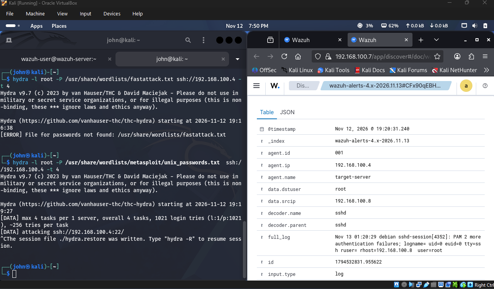
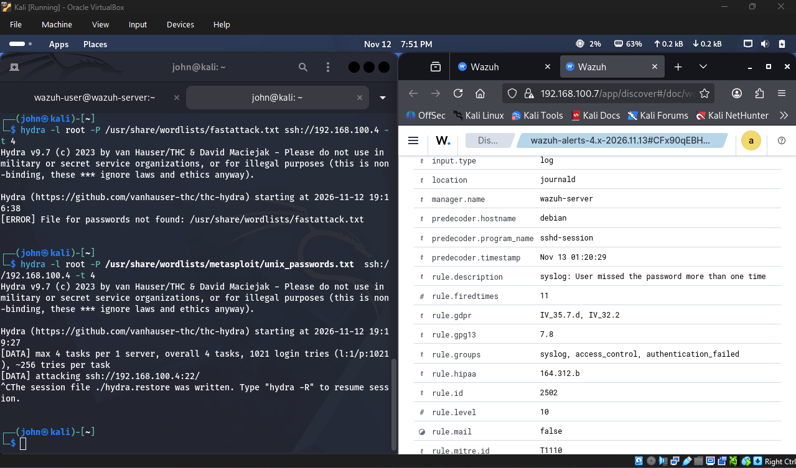

# SSH Brute-Force Simulation & SIEM Detection with Wazuh

End-to-end SSH brute-force simulation using Hydra and real-time SIEM detection with Wazuh.

## Lab Architecture (`BlueTeamNet` — `192.168.100.0/24`)
* **Attacker (`Kali Linux`):** `192.168.100.8` — Service enumeration (`nmap`) and brute-force execution (`hydra`)
* **Target (`target-server` / Debian 13):** `192.168.100.4` — OpenSSH (`22/tcp`), `rsyslog`, `wazuh-agent` v4.14.9
* **SIEM (`wazuh-server` / Wazuh OVA):** `192.168.100.7` — `wazuh-manager`, `wazuh-indexer`, `wazuh-dashboard`

---

## Phase 1: Attack Simulation & Telemetry Attribution
Executed parallel SSH credential stuffing from Kali (`192.168.100.8`) against `target-server` (`192.168.100.4`):

```bash
hydra -l root -P /usr/share/wordlists/metasploit/unix_passwords.txt ssh://192.168.100.4 -t 4
```

Wazuh ingested `/var/log/auth.log` from `target-server` in real time, attributing the failed `root` authentication attempts to Kali's IP (`192.168.100.8`):



---

## Phase 2: Rule Correlation & MITRE ATT&CK Mapping
Wazuh escalated the rapid failed logins into a **Level 10** alert (**Rule `2502`** — *syslog: User missed the password more than one time*, `firedtimes: 11`) mapped directly to **MITRE ATT&CK `T1110` (Brute Force)**:



| Rule ID | Level | Description | Role in Detection Chain |
| :--- | :--- | :--- | :--- |
| **`5760`** | 5 | `sshd: authentication failed` | Individual failed SSH login attempts |
| **`5503` / `5557`** | 5 | `PAM: User login failed` | PAM rejecting invalid password submissions |
| **`5758`** | 8 | `Maximum authentication attempts exceeded` | Parallel Hydra threads hitting OpenSSH `MaxAuthTries` |
| **`2502`** | 10 | `syslog: User missed the password more than one time` | Frequency-based escalation (`11` fired times) mapped to `T1110` |
| **`40111`** | 10 | `Multiple authentication failures` | Composite correlation linking repeated failures to `192.168.100.8` |

---

## Troubleshooting & Hardening Notes
* **Debian 13 Syslog Fix:** Installed and enabled `rsyslog` on `target-server` so `sshd` authentication logs write to `/var/log/auth.log` for `wazuh-logcollector` ingestion.
* **Wazuh Manager Lock Recovery:** Cleared stale `/var/ossec/var/start-script-lock` files after boot timeouts and verified daemon status via `wazuh-control`.
* **Production Remediation:** Disable root/password SSH login (`PermitRootLogin no`, `PasswordAuthentication no`) and enable Wazuh Active Response (`firewall-drop`) on Rule `2502` / `40111`.
